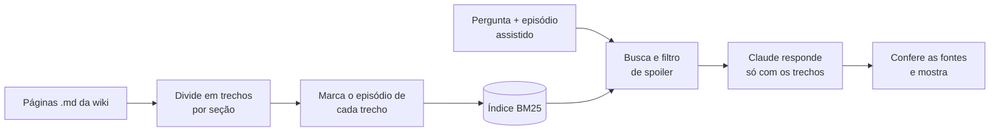

# rag-wiki-equiverso

Assistente de perguntas e respostas sobre a **Wiki do Equiverso**, uma wiki que mantenho sobre uma campanha de RPG gravada em vídeo (três temporadas, mais de 50 episódios). Você pergunta em português ("Quem matou o mosquito gigante?") e ele responde **com base só nas páginas da wiki**, mostrando de onde tirou cada informação.

A wiki tem um problema que o assistente precisava resolver: **spoilers**. Quem parou no episódio 3 não pode receber uma resposta que conta o que acontece no 20. Por isso cada trecho da wiki sabe a partir de qual episódio deixa de ser spoiler, e a busca filtra pelo episódio que o leitor diz ter assistido.

Exemplo de uso:

```text
$ rag-equiverso perguntar "Quem matou o mosquito gigante?" --ate xdq-01

Nina acabou com a luta cortando a probóscide do mosquito com um punhal,
depois que Lucas o feriu com um canivete e Ayla usou spray de pimenta.

Fontes:
  [1] XdQ 1 — O Vampiro da Piscina Pública › A história › A piscina pública (a partir de XdQ 1)
  [2] Mosquito gigante › Detalhes › O que fazia (a partir de XdQ 1)
```

## Como funciona



1. **Leitura e divisão (`documentos.py`)**: cada página é dividida pelas seções (`##`, `###`) e, se a seção for longa, em blocos de parágrafos. A ficha lateral dos personagens (em YAML) também vira trecho.
2. **Marcação de spoiler (`episodios.py`)**: as páginas citam a origem de cada fato (`[[xdq-03|XdQ 3]]`). O trecho recebe o episódio mais avançado que ele cita. A ordem cronológica cruza as três temporadas (Equinócio → Só Assim → X da Questão) e entende vídeos extras como `xdq-09-5`.
3. **Busca (`busca.py`)**: BM25 implementado do zero, com normalização para português (sem acento, sem palavras vazias, plural ≈ singular). Título e apelidos da página valem mais. No máximo 2 trechos por página, para a resposta juntar fontes variadas.
4. **Geração (`gerador.py`)**: os trechos vão numerados para o Claude (`claude-opus-5-5`), que responde em **JSON validado por esquema** (structured outputs) com a resposta, os números das fontes e se achou ou não a resposta.
5. **"Não sei" honesto**: antes de chamar a IA, o assistente mede quanto da pergunta o melhor trecho cobre, pesando cada palavra pela raridade dela. Se a cobertura for baixa ("Quem ganhou a Copa de 2002?"), ele responde que não encontrou e nem gasta uma chamada à API. Esse problema foi achado pelo [avaliador-llm](https://github.com/Borniotti/avaliador-llm).
6. **Verificação**: o programa descarta fontes que não existem e não trata como "encontrada" uma resposta sem fonte. Recusas do modelo e respostas cortadas são tratadas, e um *fallback* automático tenta outro modelo se o filtro de segurança recusar por engano.

### Decisões e por quê

| Decisão | Motivo |
|---|---|
| BM25 em vez de embeddings | A wiki é cheia de nomes próprios (Benício, Atolados, Corporação Chico), e busca por palavra-chave acerta nomes muito bem, sem outra API nem GPU. A busca fica atrás de uma interface simples, então dá para trocar por busca vetorial ou híbrida depois. |
| Filtro de spoiler **antes** do modelo | Se o trecho com spoiler nunca chega ao modelo, ele não tem como vazar. Pedir no prompt "não dê spoiler" não é garantia. |
| Saída em JSON com esquema | O programa não precisa adivinhar onde estão a resposta e as fontes no texto. |
| Modo sem IA | Sem chave de API, ele mostra o trecho mais relevante, então qualquer pessoa consegue testar a busca. |
| Cliente da API injetável | Os testes usam um cliente falso: rodam em menos de 1 segundo e não gastam nada. |

## Como rodar

```bash
pip install -e ".[dev]"
rag-equiverso indexar dados/wiki          # monta o índice (indice.json)
rag-equiverso perguntar "Quem é a Ayla?" --ate xdq-02
rag-equiverso chat --ate xdq-05           # conversa no terminal
```

Para respostas redigidas pelo Claude, defina `ANTHROPIC_API_KEY`. Sem ela, o assistente roda só com a busca.

`dados/wiki` traz uma amostra de 33 páginas (episódios 1 a 5 do X da Questão e as páginas ligadas a eles). Para indexar a wiki inteira, aponte `indexar` para a pasta `content/` do site.

## Testes

```bash
pytest
```

São 22 testes: normalização de texto, ordem dos episódios, divisão das páginas, filtro de spoiler (ninguém recebe trecho de episódio futuro), persistência do índice, o "não sei" para perguntas fora do assunto e a conversa com o modelo (fontes inventadas, recusa, resposta sem fonte), usando um cliente falso.

## Motor em JavaScript (para sites)

A pasta [`js/`](js/) tem o mesmo motor em JavaScript, sem nenhuma dependência, para rodar em sites e no Cloudflare. É ele que a própria [Wiki do Equiverso](https://wiki-equiverso.equiverso.workers.dev/pergunte) usa no chat "Pergunte à wiki", e foi feito para ser reaproveitado em outros projetos:

| Peça | Arquivo | O que faz |
|---|---|---|
| Texto | `texto.js` | normalização em português (sem acento, palavras vazias, plural ≈ singular) |
| Trechos | `trechos.js` | divide páginas Markdown por seção e marca o "nível" de cada trecho |
| Busca | `busca.js` | BM25 do zero, filtro de nível, no máximo 2 trechos por página e a cobertura para o "não sei" |
| Resposta | `resposta.js` | pedido numerado, esquema JSON, conferência das fontes e resposta **sem IA** com frases dos trechos |
| Geradores | `geradores.js` | quem escreve a resposta: **Workers AI da Cloudflare** (cota diária grátis) ou **Claude** (pago); dá para trocar sem mexer no resto |
| Entender a pergunta | `entender.js` | antes da busca, um modelo menor lê a pergunta (erros de digitação, gírias, várias partes, "o quinto episódio") e devolve as palavras certas e os episódios citados; se falhar, a busca segue sozinha (só no JavaScript, por enquanto) |
| Regra de spoiler | `episodios.js` | a ordem dos episódios do Equiverso e como reconhecer um episódio na pergunta ("ep 38 de X da Questão"); outro projeto passa a sua própria regra |

```js
import { dividirPagina, IndiceBM25, responder, geradorWorkersAI } from "rag-equiverso"
import * as episodios from "rag-equiverso/episodios"

const trechos = paginas.flatMap((p) => dividirPagina(p, { nivelBase: p.primeiraAparicao, nivel: episodios }))
// lerPergunta/termosExtras: "ep 38 de X da Questão" casa com os trechos que citam o XdQ 38
const indice = new IndiceBM25(trechos, { lerPergunta: episodios.lerPergunta, termosExtras: episodios.termosExtras })
const r = await responder(indice, "Quem é a Ayla?", {
  liberado: episodios.liberadoAte("xdq-05"),
  gerador: geradorWorkersAI(env.AI), // sem gerador, responde com as frases dos trechos
  entendedor: geradorWorkersAI(env.AI, { modelo: "@cf/openai/gpt-oss-20b" }), // opcional
  contexto: { nomes: ["Ayla", "Krave"], episodios: [["xdq-38", "Apoteose"]], valido: episodios.ehCodigo },
})
```

Sem gerador, ou quando a IA falha (por exemplo, quando a cota grátis do dia acaba), o motor responde com as frases dos próprios trechos que mais combinam com a pergunta, então o chat nunca para. Testes: `cd js && npm test` (19 testes, com geradores falsos).

## Próximos passos

- Busca híbrida (BM25 + embeddings) com reordenação.
- Avaliação automática das respostas: veja o projeto [avaliador-llm](https://github.com/Borniotti/avaliador-llm), que mede este assistente.
- ~~Interface web dentro da própria wiki~~: feito, com o motor em JavaScript.

---

Desenvolvido por Matheus Borniotti com a ajuda de IA (Claude) como par de programação.
